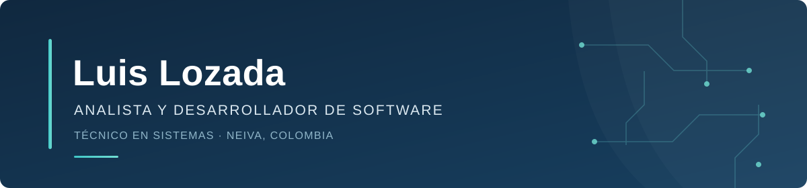

  

   
  <strong>ANÁLISIS · DESARROLLO DE SOFTWARE · SISTEMAS</strong>
    
  Neiva, Colombia
    
  <a href="https://github.com/ingdevelopers449">GitHub</a>
  &nbsp;&nbsp;|&nbsp;&nbsp;
  <a href="https://linkedin.com/in/luis-lozada">LinkedIn</a>
  &nbsp;&nbsp;|&nbsp;&nbsp;
  <a href="mailto:pipelozada994@gmail.com">Contacto profesional</a>

---

## Perfil

Analista y desarrollador de software, y Técnico en Sistemas formado en el **Servicio Nacional de Aprendizaje (SENA)**. Completé el curso de **Ingeniería de Software con IA Generativa** en la **Fundación Escuela Tecnológica de Neiva “Jesús Oviedo Pérez” (FET)**.

Mi formación integra desarrollo de software, sistemas e inteligencia artificial. Me interesa aportar a proyectos tecnológicos mediante soluciones prácticas, atención al detalle y aprendizaje continuo, con especial interés en el desarrollo backend y las tecnologías web.

## Formación

| Programa | Institución |
|---|---|
| Análisis y Desarrollo de Software | Servicio Nacional de Aprendizaje (SENA) |
| Técnico en Sistemas | Servicio Nacional de Aprendizaje (SENA) |
| Ingeniería de Software con IA Generativa · Curso finalizado | [Fundación Escuela Tecnológica de Neiva “Jesús Oviedo Pérez” (FET)](https://www.fet.edu.co/) |

## Formación complementaria

| Área | Curso o actividad formativa |
|---|---|
| Inteligencia artificial | Implementación de Soluciones de Inteligencia Artificial |
| Productividad | Informática: Microsoft Word, Excel e Internet |
| Soporte técnico | Básico en Mantenimiento de Computadores |
| Electrónica | Electrónica y Robótica Recreativa |

## Participación académica

- **Ponente** — VIII Encuentro de Experiencias Significativas de Semilleros de Investigación La Angostura (S.I.A.), Campoalegre, Huila · 27 de mayo de 2026.
- **Participante** — V Encuentro de Semilleros de Investigación y Experiencias Significativas.
- **Participante** — Primera Hackathon SENA–CPE 2020.
- **Participante** — Segunda Hackathon SENA–CPE 2020.

## Tecnologías

  
   
  Java · Python · PHP · HTML · CSS · JavaScript · React · MySQL · Git

## Proyectos seleccionados

<table>
  <tr>
    <td width="50%" valign="top">
      <strong>AirSense CEFA</strong>
      
Sistema para monitorear y analizar la calidad del aire en el Centro de Formación Agroindustrial La Angostura mediante sensores ambientales y una plataforma en Python.

      
<strong>Componentes:</strong> monitoreo de CO₂, integración de sensores y visualización de datos.

      <a href="https://github.com/ingdevelopers449/airsense-cefa">Consultar repositorio</a>
    </td>
    <td width="50%" valign="top">
      <strong>Otros proyectos</strong>
      <ul>
        <li><a href="https://github.com/ingdevelopers449/sistema-ventas-java">Sistema de Ventas en Java</a></li>
        <li><a href="https://github.com/ingdevelopers449/apps-python">Aplicaciones en Python</a></li>
        <li><a href="https://github.com/ingdevelopers449/web-php">Proyecto Web con PHP y Base de Datos</a></li>
        <li><a href="https://github.com/ingdevelopers449/react-app">Aplicación en React</a></li>
      </ul>
    </td>
  </tr>
</table>

---

  <strong>CONTACTO</strong>
    
  Neiva, Colombia &nbsp;·&nbsp;
  <a href="mailto:pipelozada994@gmail.com">pipelozada994@gmail.com</a>
    
  <a href="https://linkedin.com/in/luis-lozada">LinkedIn</a>
  &nbsp;&nbsp;|&nbsp;&nbsp;
  <a href="https://github.com/ingdevelopers449">GitHub</a>

